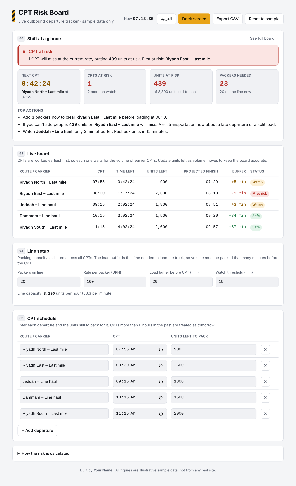
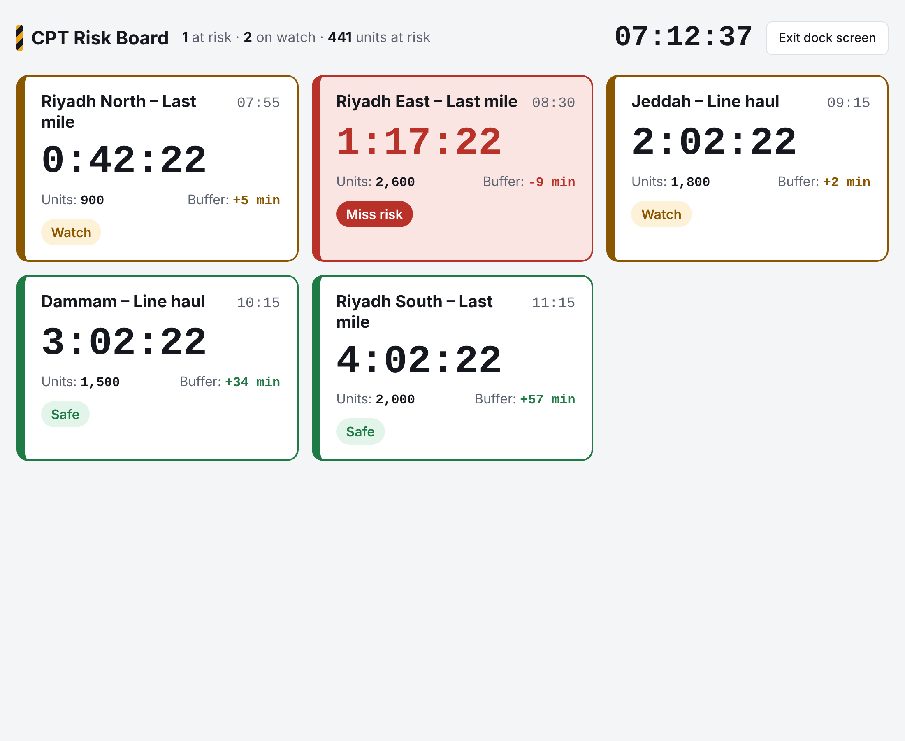

# CPT Risk Board

A live board for outbound operations that shows which **CPTs (critical pull times)** will be met at the current pack rate, how many units are at risk, and how many packers it would take to save them.

**Live demo:** https://shadlabs.github.io/cpt-risk-board/
**Arabic version:** https://shadlabs.github.io/cpt-risk-board/?lang=ar



## The problem

On an outbound floor, a missed CPT means customer orders miss their promise date. The risk is usually spotted too late, when the truck is already at the dock and there's no time left to move people. Most teams check volume against the clock by hand, one route at a time, and forget that every CPT has to wait for the volume of the CPTs before it.

I worked for almost two years as a Pack and Outbound Process Assistant. I built this board to show CPT risk early enough to act on it: add packers, reprioritize, or alert transportation while there's still time.

## What it does

- Opens with a **Shift at a glance** overview: a plain-language verdict (All on track, Watch closely, or CPT at risk), a countdown to the next CPT, CPTs at risk, units at risk, and packers needed
- Lists **top actions**, such as how many packers to add and by when, or when to escalate to transportation
- Shows a **live board** with a countdown, projected finish time, and minutes of buffer for every CPT, updated every second
- Treats packing as a **shared line worked earliest-CPT-first**, so a large early CPT correctly pushes risk onto later ones
- Accounts for **load time** before each CPT
- Has a **dock screen mode** with large color-coded tiles for a wall TV
- Works in **English and Arabic**, with a full right-to-left layout
- Exports the board to **CSV** (opens correctly in Excel in both languages)
- Saves your inputs in the browser automatically



## How the risk is calculated

| Step | Formula |
|---|---|
| Line capacity | packers × rate per packer (UPH) |
| Pack deadline | CPT time − load buffer |
| Projected finish | now + (units for this CPT and all earlier CPTs ÷ line capacity) |
| Buffer | pack deadline − projected finish |
| Status | Miss risk if buffer < 0 · Watch if buffer < watch threshold · otherwise Safe |
| Units at risk | units that cannot be packed before the pack deadline at the current rate |
| Packers needed | the most packers any upcoming CPT needs to finish its own and all earlier volume before its pack deadline |

## Tech

Plain HTML, CSS, and JavaScript. No frameworks and no build step, hosted free on GitHub Pages.

## Project structure

```
cpt-risk-board/
├── index.html             # page layout
├── css/
│   └── style.css          # styling, light and dark mode, dock screen
├── js/
│   ├── app.js             # live risk calculations, overview, dock screen, CSV export
│   └── i18n.js            # English and Arabic text
├── docs/
│   ├── screenshot.png     # English screenshot
│   ├── screenshot-ar.png  # Arabic screenshot
│   └── screenshot-dock.png
├── LICENSE
└── README.md
```

## Run it

- **Online:** open the live demo link above.
- **Locally:** download or clone the repo and open `index.html` in any browser.

The sample CPTs are created relative to the current time, so the demo always looks live. Click **Reset to sample** to refresh them.

## Data note

All routes, volumes, rates, and times are **illustrative sample data**. They are not taken from any real site or employer system.

## Related project

[Labor Planning Calculator](https://shadlabs.github.io/labor-planning-calculator/): plans headcount per process path at the start of the shift. This board tracks whether the shift is meeting its departures as it runs.

## Ideas for next version

- Per-CPT pack rate for routes with different item mixes
- Units-packed history to show the real pace against plan
- Sound alert when a CPT turns red

---
Built by **Shadrack Kpani Odametey** · [LinkedIn](https://www.linkedin.com/in/shadrack-odametey)
